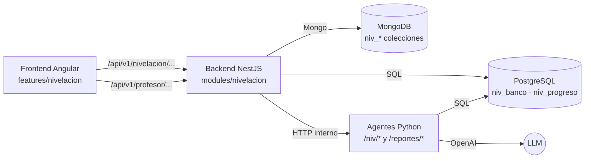

# Nivelación de Axiomante: guía para el equipo

> Para quien se suma al proyecto. Explica qué hace la nivelación, dónde está cada parte del código y cómo
> seguir. Actualizado el 17-11-2026 (rama `migracion-vm`).

## 1. Qué es

La nivelación es un módulo "hermano" del chatbot, dentro de la misma web (`/nivelacion`). Un alumno nuevo
solo ve la nivelación. Cuando la completa entera, se le habilita el chatbot.

- **Mapa**: 5 mundos y 26 nodos, en el orden del *Cuaderno de nivelación Matemática ICB-UDP* (oct. 2026).
  1. Números, potencias y raíces (5 nodos)
  2. Álgebra (5)
  3. Lineal y cuadrática: ecuaciones (6)
  4. Geometría analítica: recta, parábola, circunferencia (6)
  5. Geometría elemental (4)
- **Nodo**: 4 fases de 4 preguntas. **Mundo**: cuando completa sus nodos, se desbloquea el test del mundo
  (2 fases). Aprobar el test desbloquea el mundo siguiente.
- **Preguntas**: fases y tests usan **solo el banco de los profesores** (`niv_banco.pregunta`). La IA no
  inventa preguntas que cuenten para avanzar.
- **IA**: retroalimentación al terminar, un tutor socrático para revisar errores y un agente analista
  que ajusta el nivel del alumno.

## 2. Cómo se conectan las piezas



- El **frontend** nunca habla con los agentes ni con las bases: todo pasa por el backend.
- El **backend** corrige las respuestas, guarda el avance y decide qué se puede abrir. La respuesta
  correcta **nunca** viaja al navegador antes de tiempo.
- Los **agentes** (FastAPI) hacen todo lo que usa IA, más los reportes del panel docente (leen Postgres
  directo).

## 3. Recorrido del alumno

1. **Entra** con Google (`@mail.udp.cl`). Si está en `whitelist_alumnos` y `chatbot_habilitado = false`,
   solo puede usar la nivelación.
2. **Mapa de mundos** (`/nivelacion`): ve los 5 mundos; solo el primero sin completar está abierto.
3. **Mundo** (`/nivelacion/mundo/:id`): ve sus nodos; solo el nodo actual está abierto.
4. **Fase de un nodo** (`/nivelacion/nodo/:id/fase`), con **cola estilo Duolingo**:
   - Responde de a una pregunta y solo ve **"Correcta"** o **"Incorrecta"** (nunca cuál era la correcta).
   - Si falla, la pregunta **vuelve al final** con las alternativas en otro orden (hasta 2 reintentos).
     Si la falla por tercera vez, queda "no lograda".
   - **Aprueba con el primer intento**: 3 de 4 bien a la primera (≥ 70 %). Los reintentos son práctica.
   - Si sale a la mitad, al volver retoma donde quedó.
5. **Resultado**: puntaje, XP, la explicación de cada pregunta y la retroalimentación de la IA, pedida
   solo para las que le costaron.
6. **Tutor** (`/nivelacion/tutor?intentos=...`): solo se abre desde una pregunta respondida mal.
   - El alumno **no escribe**: cada mensaje del tutor trae 3 o 4 alternativas, más los botones
     «No entiendo» y «Dame una pista».
   - **Termina solo** cuando el alumno llega a la respuesta.
7. **Test del mundo** (`/nivelacion/mundo/:id/test`): es una prueba, se responde completo y se corrige
   al final. La fase 1 va al nivel del alumno y la fase 2 un nivel más arriba.
8. Al aprobar el test de **todos** los mundos, el backend pone `chatbot_habilitado = true` y la pantalla
   lo celebra.

Después de cada fase o test, el **agente analista** revisa los últimos 60 intentos, guarda fortalezas y
debilidades, y puede **cambiar el nivel** (Principiante / Intermedio / Avanzado). El alumno nunca elige
su nivel: parte con `whitelist_alumnos.nivel_inicial`, que cargan los profesores.

## 4. Reglas (dónde se cambian)

| Regla | Valor | Dónde |
|---|---|---|
| Fases por nodo / preguntas por fase | 4 / 4 | `REGLAS` en `backend/.../nivelacion.service.ts` |
| Para aprobar | ≥ 70 % (con el primer intento) | `REGLAS.PUNTAJE_APROBAR` |
| Reintentos por pregunta en la cola | 2 | `REGLAS.REINTENTOS_POR_PREGUNTA` |
| Test del mundo | 2 fases de 10 preguntas | `REGLAS.PREGUNTAS_POR_TEST` |
| XP | fase 10, test 250 / 500, ejercicio del tutor 5, nivel cada 100 | `REGLAS` |
| Tutor: respuestas por conversación | 12 | `.env` del backend: `TUTOR_TOPE_CONVERSACION` |
| Tutor: mensajes por alumno al día | 30 | `.env` del backend: `TUTOR_LIMITE_DIARIO` |
| Pasada de fase sin terminar | se retoma hasta 24 h | `RETOMAR_FASE_MS` en `nivelacion.service.ts` |
| Alertas del panel docente | inactivo 7 días, acierto < 50 %, etc. | constantes al inicio de `agents/.../reportes/metricas.py` |

## 5. Dónde está cada cosa

Rutas relativas a la raíz del repo. `backend` = `chatbot-icb-backend-main`, `agents` =
`chatbot-icb-agents-service-main`, `frontend` = `chatbot-icb-frontend-main`.

### 5.1 Base de datos

**PostgreSQL**: todo se crea con `deploy/sql/nivelacion.sql`. Se puede correr las veces que haga falta
porque es idempotente; también trae el mapa, las guías del cuaderno y las preguntas de muestra.

| Tabla | Qué guarda |
|---|---|
| `niv_banco.mundo` | Los 5 mundos (orden, título, descripción, ícono) |
| `niv_banco.nodo` | Los 26 nodos. `guia` = objetivos, ideas clave y errores frecuentes del cuaderno (contexto para la IA) |
| `niv_banco.pregunta` | Banco de los profesores. `tipo` = `nodo` o `test`, `dificultad`, `alternativas` (jsonb), `correcta` (debe estar entre las alternativas), `explicacion`, `activa`. Una pregunta con `nodo_id` es de ese nodo; con solo `mundo_id`, del mundo; sin ninguno, general |
| `niv_progreso.estudiante` | Un registro por alumno: `nivel`, `xp`, `entrenamientos` |
| `niv_progreso.progreso_nodo` | Fases aprobadas por alumno y nodo |
| `niv_progreso.progreso_test` | Fase del test y mejor puntaje por alumno y mundo |
| `niv_progreso.intento` | **Cada respuesta**, con copia del enunciado. `contexto` = fase / test / entrenar, `origen` = banco / generada, `n_intento` (1 = primera vez, 2 y 3 = reintentos de la cola), `sesion_id` (la pasada) |
| `niv_progreso.analisis` | Historial del agente analista |
| `whitelist_alumnos` (ya existía) | La nivelación usa `nivel_inicial`, `carrera`, `chatbot_habilitado` y `codigo_asignatura` (rol) |

**MongoDB** (estado temporal y conversaciones):

| Colección | Qué guarda |
|---|---|
| `niv_fase_sesion` | La pasada por una fase: cola de preguntas, intentos por pregunta y resultado |
| `niv_tutor` | Conversaciones del tutor (mensajes, alternativas que dio y cuál esperaba, si está cerrada) |
| `niv_tutor_uso` | Mensajes del tutor por alumno y día (límite diario) |
| `niv_retro` | Caché de la retroalimentación (no se le pide dos veces lo mismo a la IA) |
| `niv_generadas` | Ejercicios que generó la IA para el tutor (vencen a las 2 h; no entran al banco) |
| `niv_dev` | Modo dev (todo desbloqueado) por cuenta del equipo |

### 5.2 Backend (`backend/src/modules/nivelacion/`)

| Archivo | Qué hace |
|---|---|
| `nivelacion.controller.ts` | Rutas de la nivelación (tabla abajo). Solo alumnos y equipo (`SoloAlumnosGuard`) |
| `nivelacion.service.ts` | **El corazón**: `REGLAS`, mapa y desbloqueos (`estado`, `mundo`, `nodoInfo`), selección de preguntas (`poolNodo`, `poolTest`), **cola de la fase** (`preguntasFase`, `responderFase`, `cerrarFase`), test (`preguntasTest`, `responderTest`), ejercicios generados para el tutor, modo dev y aviso al analista |
| `tutor.controller.ts` / `tutor.service.ts` | Tutor y retroalimentación: abrir o retomar la conversación, responder con una alternativa o un botón de ayuda, ejercicios, límites, cierre |
| `tutor.dto.ts`, `nivelacion.dto.ts` | Validación de lo que manda el front. El tutor solo acepta `opcion` o `ayuda`, sin texto libre |
| `acceso.service.ts` | Roles (`crack` = dev, `staff` = profesor) y si el chatbot está habilitado |
| `roles.guard.ts` | `SoloAlumnosGuard` (los profesores no entran a la nivelación) y `DevGuard` |
| `chatbot-habilitado.guard.ts` | Bloquea el chatbot normal a quien no ha completado la nivelación |
| `../profesor/` | Panel docente: valida el rol staff y le pide los reportes a los agentes |

Rutas (todas con prefijo `/v1`; desde el navegador se ven como `/api/v1/...`):

| Método y ruta | Para qué |
|---|---|
| `GET nivelacion/estado` | Nivel, XP, mundos con su avance y último análisis |
| `GET nivelacion/mundos/:id` | Nodos del mundo y estado del test |
| `GET nivelacion/nodos/:id/fase` | Entrega o retoma la pasada y la pregunta que toca |
| `POST nivelacion/nodos/:id/fase/respuesta` | `{sesion_id, pregunta_id, respuesta}` → correcta o no, la siguiente pregunta y, al terminar, el resultado |
| `GET` / `POST nivelacion/mundos/:id/test` | Preguntas del test / enviar las 10 respuestas juntas |
| `POST nivelacion/retroalimentacion` | `{intento_ids}` → comentario de la IA por pregunta |
| `POST nivelacion/tutor/sesiones` | `{intento_ids}` (solo de preguntas respondidas mal) → abre o retoma la conversación |
| `POST nivelacion/tutor/sesiones/:id/mensajes` | `{opcion: n}` o `{ayuda: 'no_entiendo' \| 'pista'}` |
| `POST nivelacion/tutor/sesiones/:id/ejercicio` y `.../ejercicio/:ej/respuesta`, `.../solucion` | Ejercicios generados dentro del tutor |
| `GET` / `PUT nivelacion/dev` | Modo dev (solo `crack`) |
| `GET profesor/nivelacion`, `.../excel`, `.../alumnos/:uid` | Reporte, Excel y ficha de un alumno (solo `staff`) |

### 5.3 Agentes Python (`agents/app/routers/`)

`nivelacion/` (prefijo `/niv`, protegido con el secreto interno):

| Endpoint | Función (en `service.py`) | Qué hace |
|---|---|---|
| `POST /niv/tutor` | `tutor_responder` | Siguiente turno del tutor: `{mensaje, opciones, esperada, terminado}`. Recibe el contexto del alumno y del nodo (nivel, guía, errores recientes, preguntas a revisar) |
| `POST /niv/retroalimentar` | `retroalimentar` | Comentario por pregunta y qué reforzar |
| `POST /niv/generar` | `generar_pregunta` | Crea un ejercicio para el tutor; un revisor independiente (`_verificar_pregunta`) lo resuelve y lo descarta si no calza |
| `POST /niv/analizar` | `analizar_estudiante` | Agente analista, en segundo plano. Acierto con la primera respuesta (`n_intento = 1`) |
| `POST /niv/resolver` | `resolver_ejercicio` | **Sin uso hoy** (era para "Traigo mi ejercicio"). Se puede borrar |

Los prompts están en `nivelacion/prompts.py`. Los del tutor (`TUTOR_SYSTEM`, `TUTOR_INICIO`) definen:
socrático, una pregunta por mensaje, alternativas con errores típicos, objetivo acotado y cierre.

`reportes/` (prefijo `/reportes`): `datos.py` (consultas SQL), `metricas.py` (arma el reporte y las
alertas) y `excel.py` (el Excel). El % de acierto usa la primera respuesta; los errores cuentan todo.

### 5.4 Frontend (`frontend/src/app/features/nivelacion/`)

| Archivo | Pantalla |
|---|---|
| `niv-layout.component.ts` | Marco: header con nivel, XP, tema y cuenta. Carga el estado |
| `niv-mundos.component.ts` | Mapa de mundos y análisis del agente |
| `niv-mundo.component.ts` | Mapa de nodos de un mundo y botón para jugar la fase |
| `niv-evaluacion.component.ts` | **Fase** (cola: `comprobar()`, `continuarFase()`) y **test** (`siguiente()`), más el resultado y la retroalimentación |
| `niv-tutor.component.ts` | Tutor: mensajes, alternativas, botones de ayuda, ejercicios y cierre |
| `nivelacion.service.ts` | Cliente HTTP y tipos (`SesionFase`, `RespuestaFase`, `SesionTutor`, …) |
| `niv-theme.scss` | Estilos compartidos de la nivelación |

Otras pantallas relacionadas:
- `features/profesor/`: panel docente (resumen, por carrera, nodos, preguntas, alertas y ficha del alumno).
- `features/demo/vista-demo.component.ts`: selector de vista para demos (solo `crack`): dev, alumno o
  profesor.
- `features/inicio/`: selector Chatbot o Nivelación (develop).
- Rutas en `app.routes.ts`. Guards `nivelacionGuard` y `staffGuard` en `core/auth.guard.ts`.

### 5.5 Roles

Salen de `whitelist_alumnos.codigo_asignatura`, sin importar mayúsculas:

| Valor | Rol | Ve |
|---|---|---|
| `crack` | dev (equipo) | Todo, más el modo dev (todo desbloqueado) y el selector de vista |
| `staff` | profesor | Panel docente y chat. **Sin nivelación** |
| otro (su sección) | alumno | Nivelación; el chat solo si `chatbot_habilitado = true` |

## 6. Cómo correrlo en tu PC

Los pasos completos están en el `README.md` (sección "Levantarlo en tu PC"). En corto:

```powershell
# Bases (Postgres 55432 + Mongo 27017)
docker compose -f deploy\docker-compose.dev.yml up -d

# Esquema y datos de la nivelación (idempotente: corre de nuevo después de cada cambio al .sql)
cd deploy
docker compose -f docker-compose.dev.yml cp sql/nivelacion.sql postgres:/tmp/nivelacion.sql
docker compose -f docker-compose.dev.yml exec postgres psql -U icb_user -d icb_chatbot -f /tmp/nivelacion.sql

# Tres terminales: agentes (uvicorn :8000), backend (npm run start:dev :3000), front (npm start :4200)
```

- Para probar como alumno, tu correo tiene que estar en `whitelist_alumnos`. Con `codigo_asignatura =
  'crack'` tienes el modo dev y el selector de vista.
- Los agentes necesitan `OPENAI_API_KEY` en su `.env`. **Nunca subas los `.env` al repo.**
- **No uses** `docker compose down -v`: borra los volúmenes con los datos.

## 7. Recetas rápidas

- **Cambiar reglas** (fases, puntaje, reintentos, XP): `REGLAS` en `nivelacion.service.ts`. El front las
  recibe en `GET mundos/:id`.
- **Cambiar los límites del tutor**: `TUTOR_LIMITE_DIARIO` y `TUTOR_TOPE_CONVERSACION` en el `.env` del
  backend, y reiniciar.
- **Cambiar cómo habla el tutor**: `TUTOR_SYSTEM` en `agents/.../nivelacion/prompts.py`. Si cambias el
  formato JSON, ajusta también `_validar_turno` en `service.py` y `pedirAlTutor` en `tutor.service.ts`.
- **Cargar preguntas al banco**: insertar en `niv_banco.pregunta`. Ejemplo:
  ```sql
  INSERT INTO niv_banco.pregunta (mundo_id, nodo_id, tipo, dificultad, enunciado, alternativas, correcta, explicacion, creado_por)
  VALUES (2, (SELECT id FROM niv_banco.nodo WHERE mundo_id = 2 AND orden = 3),  -- Álgebra › Factorización
          'nodo', 'Principiante', 'Factoriza $x^2 - 9$',
          '["$(x-3)(x+3)$", "$(x-9)(x+1)$", "$(x-3)^2$", "$x(x-9)$"]', '$(x-3)(x+3)$',
          'Es una diferencia de cuadrados: $a^2-b^2=(a-b)(a+b)$.', 'profe');
  ```
  Busca el nodo por mundo y orden (los `id` pueden cambiar entre bases). La correcta tiene que estar escrita
  **igual** que una de las alternativas (lo exige una restricción). Para sacar una pregunta sin borrarla:
  `activa = false`.
- **Agregar una columna o tabla**: agrégala en `nivelacion.sql` con `IF NOT EXISTS`, para que se pueda
  volver a correr sin romper nada.
- **Ver qué pasó con un alumno**: ficha en el panel docente, o
  `SELECT * FROM niv_progreso.intento WHERE uid = '...' ORDER BY id DESC;`.

## 8. Cómo seguir (pendientes)

1. **Banco de preguntas por nodo (lo más urgente).** Hoy hay solo 4 preguntas generales de nodo por nivel
   (de la maqueta, sin `nodo_id`), así que **todas las fases muestran las mismas 4 preguntas**. Los tests
   tienen 9 de muestra por mundo (3 por nivel). Los profesores tienen que cargar las suyas por nodo y
   nivel. Apenas haya preguntas con `nodo_id`, `poolNodo` les da prioridad sola.
2. **Sistema ELO (lo implementa otro compañero).** Va a cambiar cómo se eligen las preguntas y cuántas
   fases hay (diseño en las guías ELO: 3 fases por nodo, fases mixtas 2 banco + 2 IA, test 7 + 7).
   Dónde enchufarlo:
   - **Elegir preguntas**: `poolNodo` / `preguntasFase` (fases) y `poolTest` (tests).
   - **Calcular el resultado y avanzar**: `cerrarFase` y `responderTest`.
   - **Para el ELO cuenta solo la primera respuesta** (`intento.n_intento = 1`). Los reintentos de la cola
     son práctica.
   - El tutor ya lee la columna `estudiante.elo` si existe (función `perfil` en `tutor.service.ts`), sin
     cambiar código.
   - Tutor y retroalimentación están en archivos aparte y solo dependen de `intento_id`.
3. **Probar el tutor con OpenAI real.** Todo se probó con una IA simulada. Hay que revisar que las
   alternativas tengan sentido y que cierre en el momento justo; si no, se ajusta `TUTOR_SYSTEM`.
4. **Figuras en las preguntas.** Hoy son solo texto y LaTeX; Geometría necesita imágenes (falta una
   columna y su visualización).
5. **Producción.** Los servicios en la VM están en pausa esperando el dominio y el certificado de TI. Al
   desplegar: `git pull` en la VM, correr `nivelacion.sql`, `docker compose up -d --build` (los agentes se
   reconstruyen).
6. **Limpieza menor.** Borrar `/niv/resolver`, que no se usa. Los SCSS de `chat-page` y
   `profesor-panel` superan el presupuesto de Angular: solo da un aviso, no un error.
7. **Avisar a los profesores** de errores del borrador del cuaderno: Ejemplo 2.8 (debería ser
   $x^2 - 2x + 4$), guía 3.2 ej. 4 (falta la $x$), textos de relleno (XXX, Lorem ipsum) y problemas 1.1–1.3
   repetidos.

## 9. Reglas del equipo

- La **respuesta correcta nunca va al navegador** antes de que el alumno responda. La corrección es
  siempre en el servidor.
- Los commits van a `migracion-vm`. Antes de subir: `git status` limpio y `git log origin/migracion-vm..HEAD`
  para revisar qué se sube.
- No se suben `.env`, certificados ni dumps de bases.
- Si cambias algo que afecta a los profesores (reglas, reportes), actualiza este documento y el `README.md`.
